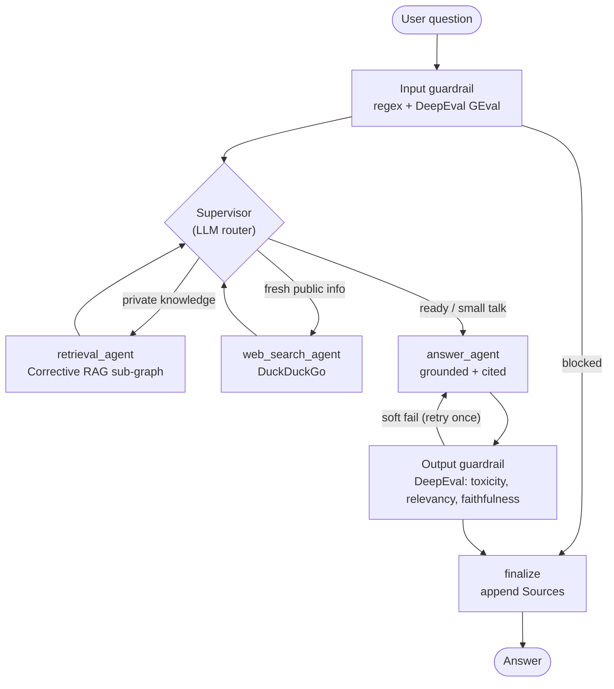
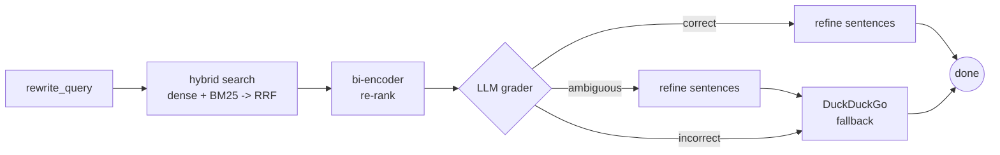
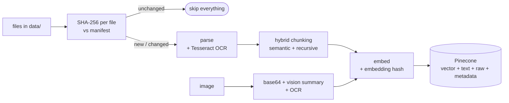

# Multimodal RAG Agent

A supervisor / sub-agent **Retrieval-Augmented Generation** assistant built with **LangGraph**.
It ingests your documents and images into **Pinecone**, answers questions with **Corrective RAG (C-RAG)**,
and routes every LLM call through a **LiteLLM** gateway to **OpenAI, Anthropic (Claude) and xAI (Grok)**.
Guardrails run on **DeepEval**, and everything is traced in **LangSmith**.

> **Scope:** you can upload *files* (documents and images). Videos, audio, URLs and website links
> cannot be uploaded and are rejected. The only tool the agents can call is **DuckDuckGo web search**.

---

## Features

| Area | What you get |
|---|---|
| **Ingestion** | PDF, DOCX, PPTX, XLSX, HTML, TXT/MD/CSV/JSON/XML/YAML and more; **Tesseract OCR** for scanned pages and for images embedded in DOCX/PPTX |
| **Chunking** | *Hybrid*: semantic split (embedding-distance breakpoints) + `RecursiveCharacterTextSplitter` as a size guard |
| **Embeddings** | Local semantic embeddings (sentence-transformers, default `BAAI/bge-small-en-v1.5`) |
| **Storage** | Pinecone: vector + chunk text + original section text + rich metadata, per chunk |
| **Images** | Converted to base64, summarised by a vision LLM, OCR'd, embedded; summary / metadata / OCR / base64 thumbnail stored in Pinecone |
| **Change detection** | SHA-256 of every file + SHA-256 of every embedding; ingestion is **skipped** unless data changed or it is the first run |
| **Retrieval** | Query rewriting (+ variants) -> **hybrid search** (dense Pinecone + BM25) fused with **RRF** -> **bi-encoder re-ranker** |
| **C-RAG** | LLM relevance grading -> *correct* / *ambiguous* / *incorrect* -> knowledge refinement and/or DuckDuckGo fallback |
| **Agents** | Supervisor routing to `retrieval_agent`, `web_search_agent`, `answer_agent`, each with its own system prompt |
| **LLM gateway** | LiteLLM `Router`: OpenAI / Anthropic / Grok, per-role model tiers, automatic cross-provider fallback |
| **Guardrails** | DeepEval metrics as runtime guards on input and output, plus regex pre-filters and indirect-injection filtering |
| **Observability** | LangSmith traces for the whole graph, every LLM call, retrieval and tool call |

---

## Architecture



### Corrective RAG sub-graph (`retrieval_agent`)



* **correct** (>= `CRAG_MIN_RELEVANT` relevant chunks): refine the chunks to the sentences that matter and answer.
* **ambiguous** (some, but too few): keep the refined chunks **and** add web results.
* **incorrect** (nothing relevant, or an empty knowledge base): answer from web results.

### Ingestion pipeline



---

## Project structure

```
multimodal-rag-agent/
├── main.py                    # CLI: ingest-if-needed, then chat
├── requirements.txt
├── .env.example               # copy to .env
├── .gitignore
├── data/                      # drop your files here (git-ignored)
├── tests/test_utils.py        # offline unit tests (hashing, RRF, metadata, JSON parsing)
└── src/
    ├── config.py              # all settings, read from .env
    ├── llm_gateway.py         # LiteLLM Router: OpenAI / Anthropic / Grok + fallbacks
    ├── prompts.py             # system prompt for every agent / role
    ├── guardrails.py          # DeepEval guards (+ regex pre-filters)
    ├── observability.py       # LangSmith setup
    ├── utils.py               # hashing, RRF, metadata fitting, JSON extraction
    ├── app.py                 # wires everything together
    ├── ingestion/
    │   ├── parsers.py         # PDF/DOCX/PPTX/XLSX/HTML/text/image parsers + OCR
    │   ├── chunking.py        # semantic + recursive hybrid chunker
    │   ├── embeddings.py      # sentence-transformers embedder
    │   ├── manifest.py        # file hashes + ids (drives "skip if unchanged")
    │   └── pipeline.py        # plan (diff) -> run (ingest / update / delete)
    ├── retrieval/
    │   ├── vector_store.py    # Pinecone wrapper
    │   ├── sparse.py          # BM25 over the local chunk cache
    │   ├── hybrid.py          # dense + sparse -> RRF
    │   └── reranker.py        # bi-encoder re-ranker + sentence refinement
    └── agents/
        ├── state.py           # LangGraph state
        ├── crag.py            # Corrective-RAG sub-graph
        ├── nodes.py           # supervisor, web agent, answer agent, guards, finalize
        ├── tools.py           # DuckDuckGo tool + allow-list
        └── graph.py           # top-level graph
```

---

## Setup

### 1. Prerequisites

* **Python 3.10+**
* **Tesseract OCR binary** (needed for scanned PDFs and images):
  * Ubuntu/Debian: `sudo apt install tesseract-ocr` (more languages: `tesseract-ocr-deu`, ...)
  * macOS: `brew install tesseract`
  * Windows: install the [UB Mannheim build](https://github.com/UB-Mannheim/tesseract/wiki) and either add it to `PATH` or set `TESSERACT_CMD` in `.env`
* A **Pinecone** account and API key (a serverless index is created automatically)
* At least one LLM API key: **OpenAI**, **Anthropic** or **xAI**
* Optional: a **LangSmith** API key for tracing

### 2. Install

```bash
git clone <your-repo-url> multimodal-rag-agent
cd multimodal-rag-agent
python -m venv .venv
source .venv/bin/activate            # Windows: .venv\Scripts\activate

# Optional, smaller CPU-only PyTorch (skip if you have a GPU or don't mind the size):
# pip install torch --index-url https://download.pytorch.org/whl/cpu

pip install -r requirements.txt
```

### 3. Configure

```bash
cp .env.example .env
# then edit .env and add your keys
```

Minimum: one LLM key, `PINECONE_API_KEY`. Set all three LLM keys to get automatic provider fallback.
Model names in `.env.example` are defaults, so **check each provider's current model list** and override
`<PROVIDER>_SMART_MODEL` / `<PROVIDER>_FAST_MODEL` if needed.

---

## Usage

Put files in `data/` (sub-folders are fine), then:

```bash
python main.py
```

* **First run:** everything in `data/` is parsed, embedded and stored in Pinecone.
* **Next runs:** files are hashed and compared with `.cache/manifest.json`. If nothing changed you will see
  `Knowledge base is up to date, ingestion skipped.` and no parsing, embedding or Pinecone writes happen.
* **Changed / new / deleted files:** only those files are re-ingested, replaced or removed.

Other commands:

```bash
python main.py --ask "What does the Q3 report say about churn?"   # one-shot
python main.py --ingest-only                                       # sync and exit
python main.py --reindex                                           # wipe the namespace and rebuild
python main.py -v                                                  # show the agent route
```

In the chat you can use:

| Command | What it does |
|---|---|
| `/upload <path>` | copy a document or image into `data/uploads/` and ingest it immediately |
| `/sources` | list ingested files with vector counts |
| `/reindex` | force a full re-ingest |
| `/new` | start a fresh conversation |
| `/exit` | quit |

Example session:

```text
you> /upload ~/Desktop/architecture-diagram.png
Ingestion finished (data changed): 1 added, 0 updated, 0 deleted, 1 vectors in 6.2s
you> What services talk to the payments database according to my diagram?
```

---

## How the key pieces work

### Change detection ("don't ingest again unless data changed")

1. Each file is hashed (SHA-256). A `(size, mtime)` pre-check avoids re-reading unchanged files.
2. The hash is compared with `.cache/manifest.json`, which also stores each file's vector ids.
3. The plan is `first run`, `settings changed`, `Pinecone namespace empty`, or a diff of added / modified / deleted files.
4. **Embedding hash:** every chunk's embedding is hashed (SHA-256 of the rounded float32 vector). The hash is stored in
   metadata (`embedding_hash`) and is part of the deterministic vector id, so re-upserting identical content
   overwrites rather than duplicates.
5. Changing any setting that affects stored data (embedding model, chunk size, OCR mode, ...) changes the config
   fingerprint and triggers a clean full re-ingest.

### What is stored in Pinecone

Per **text chunk**: the embedding plus metadata: `text` (the chunk), `raw_section` (original extracted text of the
page / slide / sheet), `source`, `file_type`, `location` (page 3, slide 5, ...), `page`, `chunk_index`, `ocr_used`,
`content_hash`, `embedding_hash`, `embedding_model`, `ingested_at`, document title/author where available.

Per **image**: the embedding of *summary + description + tags + OCR text*, plus `summary`, `description`, `tags`,
`ocr_text`, `image_b64`, `image_mime`, `image_width/height/bytes` and basic EXIF fields.

> **Pinecone limit to be aware of:** metadata is capped at 40 KB per vector. The code therefore
> (a) stores the chunk and its enclosing raw section, truncating the raw section if needed, and
> (b) stores images as a **base64 JPEG thumbnail** that fits the budget (`MAX_IMAGE_B64_BYTES`), while the
> vision model and OCR see a larger downscaled copy. Your original files stay on disk in `data/`.

### Hybrid search + RRF

For every query variant: dense top-k from Pinecone **and** BM25 top-k over the chunk texts. All rankings are fused with
Reciprocal Rank Fusion, `score(d) = sum 1 / (k + rank)` (`RRF_K=60`). The top `RRF_POOL` candidates go to the re-ranker.

BM25 runs in-process over `.cache/chunks.jsonl` (rebuilt from Pinecone automatically if the cache is missing).
That is ideal up to roughly tens of thousands of chunks; for much larger corpora, swap in Pinecone sparse-dense
vectors.

### Bi-encoder re-ranker

A *different, larger* sentence-transformers model (`RERANKER_MODEL`) embeds the query and each candidate independently,
and candidates are sorted by cosine similarity. The same model also powers C-RAG's sentence-level refinement.

### Guardrails (DeepEval)

| Stage | Checks |
|---|---|
| Input | length limit, prompt-injection regexes, DeepEval `GEval` *Input Safety* |
| Retrieved / web context | passages that look like prompt injection are dropped before generation |
| Output | secret / SSN / card-number patterns, DeepEval `ToxicityMetric`, `AnswerRelevancyMetric`, `FaithfulnessMetric` (against the retrieved context) |

Hard failures (unsafe input, toxicity, leaked secrets) block the reply. Soft failures (low relevancy / faithfulness)
trigger one regeneration with the judge's feedback; if it still fails, the answer is returned with a caution note.
The DeepEval judge is your own LiteLLM gateway, so no extra key is needed. The DeepEval metrics cost extra LLM calls;
turn parts off with `GUARD_OUTPUT_LLM`, `GUARD_FAITHFULNESS`, `GUARD_INPUT_LLM` or `GUARDRAILS_ENABLED=false`.

### LLM gateway

`src/llm_gateway.py` builds a LiteLLM `Router` with `<provider>-smart` and `<provider>-fast` aliases for every provider
that has a key. Each agent role uses a tier (cheap/fast for routing, grading, rewriting and judging; "smart" for answering and
image analysis) from `PRIMARY_PROVIDER`; if a call fails, LiteLLM falls back to the other providers. Pin any role to
any alias with `MODEL_<ROLE>=anthropic-smart` etc.

### Observability

Set `LANGSMITH_API_KEY` (and keep `LANGSMITH_TRACING=true`) to see, per question: the graph run, supervisor decisions,
the C-RAG sub-graph, each LLM call (base64 images are redacted), hybrid search and the DuckDuckGo tool call.

---

## Testing

```bash
pip install pytest
python -m pytest -q
```

The included tests cover the offline helpers (RRF, embedding hashing, metadata fitting, JSON extraction, sentence
splitting). End-to-end behaviour needs real API keys.

---

## Troubleshooting

| Symptom | Fix |
|---|---|
| `Tesseract binary not found` | Install Tesseract and/or set `TESSERACT_CMD`; the app still runs, just without OCR |
| `Pinecone index ... has dimension X` | You changed `EMBEDDING_MODEL`; use a new `PINECONE_INDEX` or delete the old index |
| Scanned PDF reports `no extractable text` | Install Tesseract; keep `OCR_MODE=auto` or use `always` |
| Provider/model errors | Verify the model names in `.env`; the gateway falls back to other providers when configured |
| DuckDuckGo returns nothing | It can rate-limit; the agent continues with whatever context it has |
| Want to start over | `python main.py --reindex`, or delete `.cache/` |

## Limitations

* Legacy Office formats (`.doc`, `.ppt`, `.xls`, `.rtf`) are rejected with a hint to convert them.
* Web results use DuckDuckGo snippets only (no page fetching).
* Image answers use stored thumbnails, so very fine detail may be lost; the text summary and OCR carry the detail.
* Retrieved documents are private data sent to your chosen LLM providers when answering. Review their data policies.

## Security notes

* Keep `.env` out of git (already in `.gitignore`).
* The tool allow-list in `src/agents/tools.py` is the single choke-point for tool use.
* Retrieved text is treated as untrusted data in the answer prompt and screened for injection patterns.
